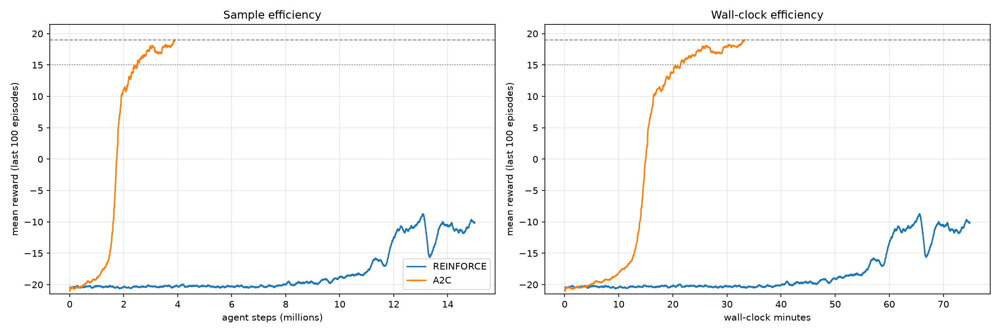

# RL on Atari Pong: REINFORCE and A2C vs DQN (CMPE 260, Project 2)

Policy-gradient agents for `ALE/Pong-v5`, compared against the DQN agents from Project 1.
The environment, preprocessing, network torso, seed (42), γ = 0.99 and "solved" rule
(mean reward of the last 100 episodes ≥ 19) are identical to Project 1. "Frames" means agent steps;
each agent step is 4 emulator frames.

## Contents

| Path | What it is |
|---|---|
| `CMPE260_Project2_PG_Pong.ipynb` | The notebook: REINFORCE, A2C, hyper-parameter sweeps, evaluation, comparison |
| `CMPE260_Project2_PG_Pong_executed.ipynb` | The same notebook with all outputs from the training run |
| `CMPE260_Project2_Extended.ipynb` | Follow-up experiments (not yet run): more seeds and longer training, plus variants of REINFORCE and A2C |
| `pong_envs.py` | Atari wrappers (written by the notebook; needed by Windows worker processes) |
| `CMPE260_Project2/` | Results of the run: logs, tables, plots, final models |

Inside `CMPE260_Project2/`:

* `reinforce_seed42/`, `a2c_seed42/`: the final runs. Each has `results.json`, `episodes.npz`
  (every episode's frame, reward, length and wall-clock time), TensorBoard logs and `best.pt`
  (the trained model).
* `sweep_*`: the hyper-parameter trials (logs only), with summaries in `sweep_reinforce.csv` and `sweep_a2c.csv`.
* `eval_*.json`: 30-episode evaluations, including the value-estimate bias measurement.
* `comparison_table.md` / `.csv`, `learning_curves.png`, `value_bias.png`: the comparison.

Resume checkpoints (`latest.pt`) and the sweep-trial models are not included because of their size.

## Results (single seed)

Training hardware: NVIDIA RTX 5080 Laptop GPU, 24 CPU cores, 16 parallel environments.

| | REINFORCE | A2C |
|---|---|---|
| Tuned settings | Adam, lr 5e-4, 16 envs × 512 steps per update | RMSprop, lr 3.5e-4, 16 envs × 5 steps per update |
| Status | not solved in 15M frames | **solved** |
| Frames to +15 | — | 2.50M |
| Frames to solve (≥ 19) | — | 3.89M |
| Best / final mean-100 reward | −8.73 / −10.15 | +19.02 / +19.02 |
| Wall-clock | 74.9 min | 33.3 min |
| Gradient updates | 1,832 | 48,684 |
| Evaluation (30 games, sampling from the policy) | −14.93 ± 2.42 | +19.70 ± 1.53 |
| Value-estimate bias, V(s) − actual return | n/a (no critic) | −0.033 |

Project 1 DQN, for reference: the ε-greedy baseline reached +15 at 0.76M frames (best mean-100 reward
18.98 in 2M frames), and NoisyNet + PER solved at 0.38M frames. DQN needs the fewest frames because it
replays each transition about 32 times. A2C reaches the same final score with more frames but in less
wall-clock time thanks to parallel environments. REINFORCE, which has no critic, learns slowest
because of its high-variance Monte-Carlo gradient.



Caveats: one seed per method. The REINFORCE sweep trials (3M frames each) all ended before
REINFORCE began improving, so they could not separate the learning rates. Wall-clock times are not
directly comparable with Project 1, which ran on Colab GPUs with one environment.

## Extended experiments

`CMPE260_Project2_Extended.ipynb` continues from the results above. It reads and writes the same
`CMPE260_Project2/` folder, so finished runs are reused and `reinforce_seed42` resumes from its
15M-frame checkpoint. That checkpoint (`latest.pt`) is not in this repository, so continuing
REINFORCE needs the original results folder; every other experiment starts from scratch. Its queue runs, in priority order:

1. **A2C seeds 43 and 44** with the tuned configuration, to test whether the A2C result is robust.
2. **REINFORCE continued to 40M frames**, to see whether it keeps improving.
3. **REINFORCE variants** at 20M frames: a learned value baseline (still Monte-Carlo targets), lr 1e-3, and rollout 256.
4. **A2C variants**: lr 7e-4 with linear decay (A2C paper setting), 20-step returns, 32 environments, and no entropy bonus.

The full queue takes roughly 11–14 hours on the RTX 5080 laptop (an upper bound, since A2C runs stop
once solved). Groups can be switched on or off in `RUN_GROUPS`, and an empty file named
`CMPE260_Project2/STOP` stops the queue cleanly between runs.

## Running it

Requirements: Python 3.10–3.12, an NVIDIA GPU, and the CUDA build of PyTorch:

```
pip install torch --index-url https://download.pytorch.org/whl/cu128
```

Open the notebook from the repository folder and run all cells; the install cell adds the remaining
packages. Runs checkpoint regularly and resume when the cell is re-run.
