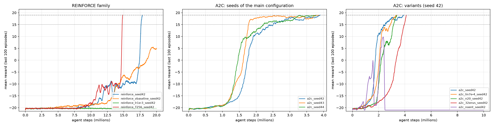

# RL on Atari Pong: REINFORCE and A2C vs DQN (CMPE 260, Project 2)

Policy-gradient agents for `ALE/Pong-v5`, compared against the DQN agents from Project 1.
The environment, preprocessing, network torso, γ = 0.99 and "solved" rule
(mean reward of the last 100 episodes ≥ 19) are identical to Project 1. "Frames" means agent steps;
each agent step is 4 emulator frames.

## Headline results

| Method | Frames to solve | Wall-clock to solve | Evaluation (30 games) |
|---|---|---|---|
| DQN NoisyNet + PER (Project 1) | **0.38M** | 62 min (Colab T4) | — |
| DQN ε-greedy baseline (Project 1) | not solved in 2M (best 18.98) | — | +19.73 ± 1.18 (ε = 0.02) |
| **A2C**, 3 seeds | 3.84M ± 0.06M | **34.3 ± 1.0 min** | +19.70 to +19.97 |
| **REINFORCE** (rollout 512) | 17.83M | 89 min | +18.40 ± 5.14 |
| REINFORCE, rollout 256 | 14.83M | 77 min | +20.23 ± 1.43 |

Project 2 runs used an NVIDIA RTX 5080 Laptop GPU, 24 CPU cores and 16 parallel environments, so
wall-clock times are not directly comparable with Project 1 (Colab GPUs, one environment).

**Takeaways**

* **Sample efficiency follows the theory:** DQN, which replays each frame about 32 times, needs the
  fewest frames; A2C needs about 10× more; REINFORCE about 4–5× more than A2C.
* **A2C is the fastest in wall-clock time and very consistent:** three seeds solved within 3.77M–3.89M frames and 33–35 min.
* **REINFORCE learns, but late and suddenly:** it stays near −20 for about 8–10M frames, then breaks
  through (−10 to +19 in under 1M frames). Updating twice as often (rollout 256) solved 3M frames sooner.
* **Entropy regularisation is essential:** A2C without the entropy bonus became deterministic by
  1.5M frames, briefly reached +9.8, then collapsed to −21 and never recovered.
* **REINFORCE is learning-rate sensitive:** at lr 1e-3 the policy stayed essentially random (entropy at its
  maximum) for all 20M frames.
* **A2C's critic is nearly unbiased:** V(s) − actual return is between −0.05 and +0.01 for the three seeds.

All variants use a single seed, and the DQN over-estimation measurement is still missing (it needs the
Project 1 checkpoints).



## All runs

| Run | Change | Result | Frames to solve | Minutes | Eval (stochastic) | V(s) bias |
|---|---|---|---|---|---|---|
| `a2c_seed42` | tuned A2C (RMSprop, lr 3.5e-4, 5-step) | solved | 3.89M | 33.3 | +19.70 ± 1.53 | −0.033 |
| `a2c_seed43` | seed 43 | solved | 3.86M | 35.3 | +19.77 ± 1.23 | +0.005 |
| `a2c_seed44` | seed 44 | solved | 3.77M | 34.4 | +19.97 ± 1.33 | −0.051 |
| `a2c_lin7e-4_seed42` | lr 7e-4, linear decay | solved | 3.37M | 28.1 | +17.50 ± 2.17 | +0.045 |
| `a2c_n20_seed42` | 20-step returns | solved | 3.40M | 19.4 | +20.07 ± 1.98 | −0.066 |
| `a2c_32envs_seed42` | 32 environments | solved | 4.11M | 22.0 | +17.90 ± 2.12 | +0.166 |
| `a2c_noent_seed42` | no entropy bonus | collapsed (peak +9.8, end −21) | — | — | +9.30 ± 0.90 | +0.052 |
| `reinforce_seed42` | tuned REINFORCE (Adam, lr 5e-4, rollout 512) | solved | 17.83M | 89.1 | +18.40 ± 5.14 | n/a |
| `reinforce_T256_seed42` | rollout 256 | solved | 14.83M | 77.3 | +20.23 ± 1.43 | n/a |
| `reinforce_vbaseline_seed42` | learned V(s) baseline | +5.0 at 20M, still rising | — | — | +5.10 ± 3.21 | −0.161 |
| `reinforce_lr1e-3_seed42` | lr 1e-3 | never learned (−20.3) | — | — | −20.33 ± 0.87 | n/a |

Full metrics are in `CMPE260_Project2/extended_results.md` (and `.csv`). Evaluations use the
checkpoint with the best training mean-100 reward, sampling from the policy.

## Contents

| Path | What it is |
|---|---|
| `CMPE260_Project2_PG_Pong.ipynb` | Main notebook: REINFORCE, A2C, hyper-parameter sweeps, evaluation, comparison |
| `CMPE260_Project2_PG_Pong_executed.ipynb` | Main notebook with the outputs of the first run |
| `CMPE260_Project2_Extended.ipynb` | Extended experiments: more seeds, longer REINFORCE training, REINFORCE and A2C variants |
| `CMPE260_Project2_Extended_executed.ipynb` | Extended notebook with the outputs of its run |
| `pong_envs.py` | Atari wrappers (written by the notebooks; needed by Windows worker processes) |
| `CMPE260_Project2/` | All results |

Inside `CMPE260_Project2/`:

* One folder per run (`a2c_*`, `reinforce_*`), each with `results.json`, `episodes.npz` (every
  episode's frame, reward, length and wall-clock time) and TensorBoard logs. `reinforce_seed42/` and
  `a2c_seed42/` also contain the trained model (`best.pt`); `reinforce_seed42/best.pt` is the solved model.
* `sweep_*`: the hyper-parameter trials from the first run, summarised in `sweep_reinforce.csv` and `sweep_a2c.csv`.
* `eval_*.json`: 30-episode evaluations, including the value-estimate bias measurement.
* `extended_results.*`, `extended_learning_curves.png`, `extended_queue_log.jsonl`: the extended comparison.
* `comparison_table.*`, `learning_curves.png`, `value_bias.png`, `eval_reinforce_seed42_greedy.json`:
  from the first run, when REINFORCE had trained for 15M frames and had not yet solved. They are kept
  as a record of that run; the extended files supersede them for REINFORCE.

Resume checkpoints (`latest.pt`) and the models of the other runs are not included because of their size.

## How the experiments were run

1. **Main notebook (first run):** short hyper-parameter sweeps (3M frames per REINFORCE trial, 2M per
   A2C trial), then the winning settings continued as the main runs. A2C solved; REINFORCE reached
   −10 after 15M frames. The REINFORCE sweep ended before any trial started improving, so it could not
   separate the learning rates.
2. **Extended notebook:** A2C seeds 43 and 44; REINFORCE resumed from 15M (it solved at 17.83M); REINFORCE
   variants at 20M frames; and A2C variants capped at 10M frames, stopping once solved. The whole queue took
   9 h 20 min on the RTX 5080 laptop.

## Running it

Requirements: Python 3.10–3.12, an NVIDIA GPU, and the CUDA build of PyTorch:

```
pip install torch --index-url https://download.pytorch.org/whl/cu128
```

Open a notebook from the repository folder and run all cells; the install cell adds the remaining
packages. Runs checkpoint regularly and resume when the cell is re-run, and finished runs are reused.
In the extended notebook, an empty file named `CMPE260_Project2/STOP` stops the queue cleanly between
runs. Continuing a run from where it stopped needs its `latest.pt`, which is not in this repository.
